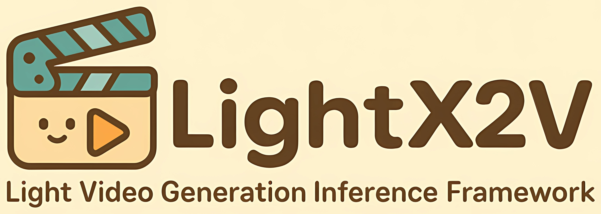

<div align="center" style="font-family: charter;">
  <h1>⚡️ LightX2V:<br> 轻量级视频生成推理框架</h1>

</img>

[](https://opensource.org/licenses/Apache-2.0)
[](https://lightx2v-en.readthedocs.io/en/latest)
[](https://lightx2v-zhcn.readthedocs.io/zh-cn/latest)
[](https://hub.docker.com/r/lightx2v/lightx2v/tags)

**\[ [English](README.md) | 中文 \]**

</div>

--------------------------------------------------------------------------------

**LightX2V** 是一个先进的轻量级图像视频生成推理框架，专为提供高效、高性能的图像视频生成解决方案而设计。该统一平台集成了多种前沿的图像视频生成技术，支持文本生成视频(T2V)和图像生成视频(I2V)，文本生成图像(T2I)，图像编辑(I2I)等多样化生成任务。**X2V 表示将不同的输入模态(X，如文本或图像)转换为视觉输出(Vision)**。

[快速开始](#-快速开始) · [模型生态](#-支持的模型生态) · [文档与部署](#-文档与部署)

> 🌐 **在线体验基于 LightX2V 的 AI 数字人与多模态内容生产平台： [LightX2V Studio](https://x2v.light-ai.top/)**

> 🍎 **MacBook 本地推理 App: [LightX2V APP](https://github.com/ModelTC/LightX2V-Mac-App)**

> 🤗 **HuggingFace 模型仓库: [LightX2V HuggingFace](https://huggingface.co/lightx2v)**

> 🌟 **开发者新手入门教程: [LightX2V 开发者快速入门教程](docs/ZH_CN/source/getting_started/first_generation.md)**

> 📝 **技术博客：[LightX2V Blog](https://light-ai.top/LightX2V-BLOG/)**

> 👋 **加入微信交流群，LightX2V加群机器人微信号: Jo-1212liz**

## 🧾 社区代码贡献指南

在提交之前，请确保代码格式符合项目规范。可以使用如下执行命令，确保项目代码格式的一致性。

```bash
pip install ruff pre-commit
pre-commit run --all-files
```

感谢以下社区开发者为 LightX2V 作出的贡献：

[zhtshr](https://github.com/zhtshr) · [triple-Mu](https://github.com/triple-Mu) · [vivienfanghuagood](https://github.com/vivienfanghuagood) · [yeahdongcn](https://github.com/yeahdongcn) · [kikidouloveme79](https://github.com/kikidouloveme79) · [ziyanxzy](https://github.com/ziyanxzy) · [Tyr0727](https://github.com/Tyr0727) · [hufangjian2017](https://github.com/hufangjian2017) · [Fatemanx](https://github.com/Fatemanx) · [qiuxin2012](https://github.com/qiuxin2012)

## :fire: 最新动态

- **2026年10月26日：** 🚀 新增 [TaoMate-H3](scripts/taomate_h3/run_t2av_3step.sh)、[StreamRender-H3](scripts/streamrender_h3/run_refv2v_2step.sh)、[Matrix-Game-4](scripts/matrix_game4/run_matrix_game4.sh)、[LingBot-Fast](scripts/lingbot_fast/run_5090.sh) 和 [Realtime-Video](scripts/realtime_video/run_5090.sh) 的自回归推理支持。对应目录提供运行脚本及 BF16/FP8 配置。

- **2026年10月18日：** 🚀 我们现已支持 [EdenLive](scripts/edenlive/README_zh.md)，结合文本提示词、首帧图像和 proxy 录屏控制视频生成，覆盖 Wan2.1 14B 与 Wan2.2 5B 的双向及 4 步自回归推理。提供 RTX 5090 与 H100/H200 实时配置，模型转换、量化及流式推理用法请参考[部署指南](scripts/edenlive/README_zh.md)。

- **2026年10月13日：** 🎉 我们发布了 [LightX2V APP](https://github.com/ModelTC/LightX2V-Mac-App)，支持在 MacBook 上本地运行 Qwen-Image-2.1 的 [Turbo](https://huggingface.co/Qwen/Qwen-Image-2.1-Turbo)、[PE-T2I GGUF Q8_0](https://huggingface.co/lightx2v/Qwen-Image-2.1-PE-T2I-GGUF-Q8_0) 和 [PE-I2I GGUF Q8_0](https://huggingface.co/lightx2v/Qwen-Image-2.1-PE-I2I-GGUF-Q8_0) 模型。

- **2026年9月22日：** 🚀 我们支持并优化了 [SwiftVR](https://huggingface.co/H-oliday/SwiftVR)，用于图像和视频的修复与超分辨率。详见 [使用说明](scripts/swiftvr/README_zh.md)。

- **2026年9月20日：** 🚀 我们 day 0 支持了 [Qwen-Image-2.1](https://huggingface.co/Qwen/Qwen-Image-2.1)，支持文生图与基于提示词的图像编辑。详见 [使用说明](scripts/qwen_image_21/README_zh.md)。

- **2026年8月27日：** 🚀 我们发布了 [MiniMax-H3 Turbo 8 步 768p 蒸馏 LoRA](https://huggingface.co/lightx2v/Minimax-h3-Turbo/blob/main/minimax_h3_fl2v_turbo_8step_v1.0_768p_bf16.safetensors)，支持 MiniMax-H3 以 8 步推理生成 768p 同步音视频。详见 [MiniMax-H3 使用说明](scripts/minimax_h3/README_zh.md)。

- **2026年8月11日：** 🚀 我们发布并支持了 [MiniMax-H3 Turbo 4 步 768p 蒸馏 LoRA](https://huggingface.co/lightx2v/Minimax-h3-Turbo/blob/main/minimax_h3_fl2v_turbo_4step_v1.0_768p_bf16.safetensors)，支持通过 4 步无 CFG 推理生成 768p 同步音视频。详见 [MiniMax-H3 使用说明](scripts/minimax_h3/README_zh.md)。

<details>
<summary>历史动态</summary>

- **2026年8月7日：** 🚀 我们正式支持了 [MiniMax-H3](https://huggingface.co/MiniMaxAI/MiniMax-H3) 的同步音视频生成，并发布了 [提示词改写 LoRA](https://huggingface.co/lightx2v/MiniMax-H3-Prompt-Rewriter-LoRA)，可将简短提示词扩展为包含画面、音景和音乐的结构化描述。详见 [MiniMax-H3 使用说明](scripts/minimax_h3/README_zh.md)。

- **2026年7月28日：** 🚀 我们发布了 LingBot-Video 的 4 步蒸馏 LoRA：[LightLingBot-Video](https://huggingface.co/lightx2v/LightLingBot-Video)。该 LoRA 支持 T2V、T2I 和 I2V 任务，只需 4 步且无需 CFG 即可完成推理。使用方式请参考 [LingBot-Video 推理脚本](scripts/lingbot_video)。

- **2026年7月23日：** 🎉 我们发布 [LightX2V ROS: Closing the Loop for Action-Generating World Models](https://light-ai.top/LightX2V-BLOG/posts/LightX2V_ROS/) 博客

- **2026年7月19日：** ⚡️ 我们发布 [Wan2.2-NVFP4-Sparse: Extremely Fast Wan 2.2 14B Inference](https://light-ai.top/LightX2V-BLOG/posts/LightWan22-A14B/) 博客

- **2026年6月15日：** 🚀 支持平头哥 PPU 的部署。

- **2026年5月29日：** 🚀 我们推出了一个极其高效的 Wan 2.2 14B 变体 (T2V and I2V)：[面向 Blackwell 架构的 NVFP4 量化感知步数蒸馏与稀疏注意力模型](https://huggingface.co/lightx2v/Wan2.2-NVFP4-Sparse)。在 [模型卡所列测试条件](https://huggingface.co/lightx2v/LightWan2.2-A14B) 下，单张 RTX 5090 上的 4 NFE 推理相比原模型的 40 NFE 推理，实现超过 50 倍的端到端加速。

- **2026年4月30日：** 🚀 支持天数智芯的部署，感谢天数智芯团队。

- **2026年4月20日：** 🚀 我们很高兴发布 [Wan2.2-I2V-A14B-4step-720p-high](https://huggingface.co/lightx2v/Wan2.2-Distill-Models/blob/main/wan2.2_i2v_A14b_high_noise_lightx2v_4step_720p_260412.safetensors) 和 [Wan2.2-I2V-A14B-4step-720p-low](https://huggingface.co/lightx2v/Wan2.2-Distill-Models/blob/main/wan2.2_i2v_A14b_low_noise_lightx2v_4step_720p_260412.safetensors) 两个新模型。与之前的版本相比，这一版本基于高质量的 720p 数据集进行训练，并采用了优化过的低噪声训练算法。这些改进显著提升了模型在细粒度细节渲染以及视觉纹理方面的表现。

- **2026年4月17日：** 🚀 我们支持了 [WorldMirror 2.0](https://github.com/Tencent-Hunyuan/HY-World-2.0.git) 模型。在单张 H100 显卡上，LightX2V 可实现约 1.2 倍的推理加速。详细用法请参考 [此教程](scripts/worldmirror/README_zh.md)。

- **2026年4月10日：** 🎉 我们更新了分离部署的技术博客
  - [LightX2V 分离部署：突破扩散模型推理的显存与吞吐瓶颈](https://light-ai.top/LightX2V-BLOG/posts/Disaggregation/)

- **2026年3月5日：** 🚀 支持 Intel AIPC PTL 的部署，感谢 Intel 团队。

- **2026年3月5日：** 🚀 我们现已支持基于 [Mooncake](https://github.com/kvcache-ai/Mooncake) 的分离部署，更多关于分离部署的改进和文档正在进行中。感谢 Mooncake 团队的帮助！

- **2026年2月27日：** 🚀 我们现已支持自回归视频生成模型（[Self Forcing](https://github.com/guandeh17/Self-Forcing)）的 **FP8 和 NVFP4 量化**！你可以在这里获取量化后的模型：**[Self-Forcing-FP8](https://huggingface.co/lightx2v/Self-Forcing-FP8)， [Self-Forcing-NVFP4](https://huggingface.co/lightx2v/Self-Forcing-NVFP4)**。

- **2026年2月11日：** 🎉 我们很高兴宣布推出 **[GenRL](https://github.com/ModelTC/GenRL)** —— 一个用于视觉生成的可扩展强化学习训练框架！GenRL 支持使用 GRPO 算法对 diffusion/flow 模型进行多奖励优化训练（HPSv3、VideoAlign 等）。我们已经发布了在多机多卡上训练的高性能 LoRA checkpoints，在美学质量、运动连贯性和文本-视频对齐等方面都有显著提升。欢迎查看我们在 HuggingFace 上的 [模型合集](https://huggingface.co/collections/lightx2v/genrl)！觉得有用的话欢迎给个 ⭐！

- **2026年1月20日：** 🚀 我们支持了 [LTX-2](https://huggingface.co/Lightricks/LTX-2) 音频-视频生成模型，包含 CFG 并行、block 级别 offload、FP8 per-tensor 量化等先进特性。使用示例可参考 [scripts/ltx2/inference](https://github.com/ModelTC/LightX2V/tree/main/scripts/ltx2/inference) 和 [scripts/ltx2](https://github.com/ModelTC/LightX2V/tree/main/scripts/ltx2)。

- **2026年1月6日：** 🚀 我们更新了 [Qwen-Image-2512](https://huggingface.co/Qwen/Qwen-Image-2512) 和 [Qwen/Qwen-Image-Edit-2511](https://huggingface.co/Qwen/Qwen-Image-Edit-2511) 的 8 步的 CFG/步数蒸馏模型。可以在 [Qwen-Image-Edit-2511-Lightning](https://huggingface.co/lightx2v/Qwen-Image-Edit-2511-Lightning) 和 [Qwen-Image-2512-Lightning](https://huggingface.co/lightx2v/Qwen-Image-2512-Lightning) 下载对应的权重进行使用。使用教程参考 [这里](scripts/qwen_image/README_zh.md)。

- **2026年1月6日：** 🚀 支持燧原 Enflame S60 (GCU) 的部署。

- **2025年12月31日：** 🚀 我们 day 0 支持了 [Qwen-Image-2512](https://huggingface.co/Qwen/Qwen-Image-2512) 文生图模型。我们的 [HuggingFace](https://huggingface.co/lightx2v/Qwen-Image-2512-Lightning) 已经更新了 CFG/步数蒸馏 LoRA 权重。使用方式可以参考 [这里](scripts/qwen_image/README_zh.md)。

- **2025年12月27日：** 🚀 支持摩尔线程 MUSA 的部署。

- **2025年12月25日：** 🚀 支持 AMD ROCm 和 Ascend 910B 的部署。

- **2025年12月23日：** 🚀 我们 day 0 支持了 [Qwen/Qwen-Image-Edit-2511](https://huggingface.co/Qwen/Qwen-Image-Edit-2511) 的图像编辑模型，H100 单卡，LightX2V 可带来约 1.4 倍的速度提升，支持 CFG 并行/Ulysses 并行，高效 Offload 等技术。我们的 [HuggingFace](https://huggingface.co/lightx2v/Qwen-Image-Edit-2511-Lightning) 已经更新了 CFG/步数蒸馏 LoRA 和 FP8 权重。使用方式可以参考 [这里](scripts/qwen_image/README_zh.md)。结合 LightX2V，4 步 CFG/步数蒸馏，FP8 模型，最高可以加速约 42 倍。可以在 [LightX2V 在线服务](https://x2v.light-ai.top/login) 的图生图的 Qwen-Image-Edit-2511 进行体验。

- **2025年12月22日：** 🚀 新增 **Wan2.1 NVFP4 量化感知 4 步蒸馏模型** 支持；模型与权重已发布在 HuggingFace： [Wan-NVFP4](https://huggingface.co/lightx2v/Wan-NVFP4)。

- **2025年12月15日：** 🚀 支持海光 DCU 硬件上的部署。

- **2025年12月4日：** 🚀 支持 GGUF 格式模型推理，以及在寒武纪 MLU590、MetaX C500 硬件上的部署。

- **2025年11月24日：** 🚀 我们发布了 HunyuanVideo-1.5 的 4 步蒸馏模型！这些模型支持**超快速 4 步推理**，无需 CFG 配置，相比标准 50 步推理可实现约**25 倍加速**。现已提供基础版本和 FP8 量化版本：[Hy1.5-Distill-Models](https://huggingface.co/lightx2v/Hy1.5-Distill-Models)。

- **2025年11月21日：** 🚀 我们 day 0 支持了 [HunyuanVideo-1.5](https://huggingface.co/tencent/HunyuanVideo-1.5) 的视频生成模型，同样 GPU 数量，LightX2V 可带来约 2 倍以上的速度提升，并支持更低显存 GPU 部署（如 24G RTX4090）。支持 CFG 并行/Ulysses 并行，高效 Offload，TeaCache/MagCache 等技术。同时支持沐曦，寒武纪等国产芯片部署。我们很快将在我们的 [HuggingFace 主页](https://huggingface.co/lightx2v) 更新更多模型，包括步数蒸馏，VAE 蒸馏等相关模型。量化模型和轻量 VAE 模型现已可用：[Hy1.5-Quantized-Models](https://huggingface.co/lightx2v/Hy1.5-Quantized-Models) 用于量化推理，[HunyuanVideo-1.5 轻量 TAE](https://huggingface.co/lightx2v/Autoencoders/blob/main/lighttaehy1_5.safetensors) 用于快速 VAE 解码。使用教程参考 [这里](https://github.com/ModelTC/LightX2V/tree/main/scripts/hunyuan_video_15)，或查看 [Python API 指南](docs/ZH_CN/source/getting_started/python_api.md) 获取代码示例。

</details>

## 💡 快速开始

推荐通过服务接口使用 LightX2V，以下分别展示 Qwen-Image-2.1 文生图（T2I）和 MiniMax-H3 文生音视频（T2AV）。

### 环境准备

推荐使用 [Docker 环境](https://lightx2v-zhcn.readthedocs.io/zh-cn/latest/getting_started/quickstart.html)。在准备好的环境中获取仓库：

```bash
git clone https://github.com/ModelTC/LightX2V.git
cd LightX2V
```

<details>
<summary>其他安装方式（Git / 源码）</summary>

以下命令在准备好的 Python 环境中运行；服务示例使用上方克隆的仓库脚本。

#### 从 Git 安装

```bash
pip install -v git+https://github.com/ModelTC/LightX2V.git
```

#### 从源码安装（仓库根目录）

```bash
uv pip install -v . # 或：pip install -v .
```

注意力与量化算子安装见 [环境准备指南](https://lightx2v-zhcn.readthedocs.io/zh-cn/latest/getting_started/quickstart.html#id9)。

</details>

### 使用示例

两个服务默认都使用 `8000` 端口，切换示例前请先停止已有服务。

#### Qwen-Image-2.1：文生图

按 [Qwen-Image-2.1 使用说明](scripts/qwen_image_21/README_zh.md) 准备权重，并设置启动脚本中的仓库路径、模型路径和显卡。以下命令在仓库根目录运行。

```bash
# 终端 1：启动服务
bash scripts/qwen_image_21/server/start_server.sh
```

模型加载完成后，在另一个终端提交示例请求：

```bash
# 终端 2：提交 T2I 请求
python scripts/qwen_image_21/server/post_t2i.py
```

修改 [请求脚本](scripts/qwen_image_21/server/post_t2i.py) 中的提示词、尺寸和种子即可生成自己的图片。请求完成后，图片默认保存到仓库下的 `save_results/qwen_image_21_t2i.png`。

#### MiniMax-H3：文生音视频

按 [MiniMax-H3 使用说明](scripts/minimax_h3/README_zh.md) 准备权重与首次 AdaLN 缓存，设置启动脚本中的仓库路径、模型路径和显卡。以下命令在仓库根目录运行。

```bash
# 终端 1：启动服务
bash scripts/minimax_h3/server/start_server.sh
```

模型加载完成后，在另一个终端提交示例请求：

```bash
# 终端 2：提交 T2AV 请求
python scripts/minimax_h3/server/post_t2av.py
```

修改 [请求脚本](scripts/minimax_h3/server/post_t2av.py) 中的提示词即可生成自己的内容。请求异步执行，结果默认保存到仓库下的 `save_results/server_cache/outputs/` 目录。

## 🤖 支持的模型生态

LightX2V 支持多种图像、视频与世界模型，并提供量化权重、蒸馏模型和轻量自编码器。

<details>
<summary><strong>🎬 视频与音视频生成</strong><br><br>
<a href="https://huggingface.co/Wan-AI/">Wan</a> · <a href="scripts/ltx2/README_zh.md">LTX</a> · <a href="scripts/minimax_h3/README_zh.md">MiniMax-H3</a> · <a href="scripts/hunyuan_video_15/README.md">HunyuanVideo</a> · <a href="scripts/lingbot_video">LingBot-Video</a> · <a href="scripts/seko_talk">SekoTalk</a> · <a href="scripts/infinitetalk">InfiniteTalk</a> · <a href="scripts/self_forcing/README_zh.md">Self-Forcing</a>
</summary>

| 模型 / 变体与权重 | 使用指南 / 脚本 |
| --- | --- |
| [MiniMax-H3](https://github.com/MiniMax-AI/MiniMax-H3)（Causal 分支支持 RefA2V，需专用权重） | [使用指南](scripts/minimax_h3/README_zh.md) · [Causal](scripts/minimax_h3_causal) |
| TaoMate-H3（自回归 T2AV） | [推理脚本](scripts/taomate_h3/run_t2av_3step.sh) |
| StreamRender-H3（自回归 RefV2V） | [推理脚本](scripts/streamrender_h3/run_refv2v_2step.sh) |
| [LTX-2](https://huggingface.co/Lightricks/LTX-2) / [LTX-2.3](https://huggingface.co/Lightricks/LTX-2.3)（自回归分支需专用权重） / [LTX-2.5](https://huggingface.co/Lightricks/LTX-2.5)（蒸馏版） | [使用指南](scripts/ltx2/README_zh.md) · [自回归示例](scripts/ltx2/ltx2_3/run_ltx2_3_ar_t2av.sh) |
| [HunyuanVideo-1.5](https://huggingface.co/tencent/HunyuanVideo-1.5) | [使用指南](scripts/hunyuan_video_15/README.md) |
| [Wan2.1 / Wan2.2](https://huggingface.co/Wan-AI/) | [Wan2.1](scripts/wan/README_zh.md) · [Wan2.2](scripts/wan22/README_zh.md) |
| [Wan2.1-VACE](https://huggingface.co/Wan-AI/Wan2.1-VACE-14B) / [Wan2.2-VACE-Fun-A14B](https://huggingface.co/alibaba-pai/Wan2.2-VACE-Fun-A14B) | [Wan2.1](scripts/wan/README_zh.md) · [Wan2.2](scripts/wan22_moe_vace) |
| [Wan2.2-S2V](https://huggingface.co/Wan-AI/Wan2.2-S2V-14B) | [使用指南](scripts/wan22/README_zh.md) |
| [Wan2.2-Animate](https://huggingface.co/Wan-AI/Wan2.2-Animate-14B) / [Wan2.2-Animate-2](https://huggingface.co/Wan-AI/Wan2.2-Animate-2-14B)（蒸馏版） | [使用指南](scripts/wan22/README_zh.md) |
| LingBot-Video [Dense 1.3B](https://huggingface.co/robbyant/lingbot-video-dense-1.3b) / [MoE 30B-A3B](https://huggingface.co/robbyant/lingbot-video-moe-30b-a3b) | [推理脚本](scripts/lingbot_video) |
| [SekoTalk](https://github.com/OpenSenseNova/SekoTalk)（含自回归分支） | [推理脚本](scripts/seko_talk) |
| [InfiniteTalk](https://huggingface.co/MeiGen-AI/InfiniteTalk) | [推理脚本](scripts/infinitetalk) |
| [Wan-Dancer](https://huggingface.co/Wan-AI/Wan-Dancer-14B) | [推理脚本](scripts/wan_dancer) |
| [Self-Forcing](https://github.com/guandeh17/Self-Forcing) | [使用指南](scripts/self_forcing/README_zh.md) |

</details>

<details>
<summary><strong>🎨 图像生成与编辑</strong><br><br>
<a href="scripts/qwen_image/README_zh.md">Qwen-Image</a> · <a href="scripts/flux2">FLUX.2</a> · <a href="scripts/hunyuan_image3">HunyuanImage</a> · <a href="scripts/z_image/README_zh.md">Z-Image</a> · <a href="scripts/longcat/README_zh.md">LongCat-Image</a> · <a href="scripts/bagel/README.md">BAGEL</a> · <a href="scripts/hidream_o1_image">HiDream</a> · <a href="scripts/ernie_image">ERNIE-Image</a> · <a href="scripts/neopp/README.md">SenseNova-U1</a>
</summary>

| 模型 / 变体与权重 | 使用指南 / 脚本 |
| --- | --- |
| [Qwen-Image](https://huggingface.co/Qwen/Qwen-Image) / [Qwen-Image-2512](https://huggingface.co/Qwen/Qwen-Image-2512) | [使用指南](scripts/qwen_image/README_zh.md) |
| [Qwen-Image-Edit](https://huggingface.co/Qwen/Qwen-Image-Edit) / [2509](https://huggingface.co/Qwen/Qwen-Image-Edit-2509) / [2511](https://huggingface.co/Qwen/Qwen-Image-Edit-2511) | [使用指南](scripts/qwen_image/README_zh.md) |
| [Qwen-Image-2.1](https://huggingface.co/Qwen/Qwen-Image-2.1) / [Turbo](https://huggingface.co/Qwen/Qwen-Image-2.1-Turbo) | [使用指南](scripts/qwen_image_21/README_zh.md) |
| [Qwen-Image-Layered](https://huggingface.co/Qwen/Qwen-Image-Layered) | [使用指南](scripts/qwen_image/README_zh.md) |
| FLUX.2 [dev](https://huggingface.co/black-forest-labs/FLUX.2-dev) / [klein](https://huggingface.co/black-forest-labs/FLUX.2-klein-9B)（klein 支持 Base 与蒸馏版） | [推理脚本](scripts/flux2) |
| [HunyuanImage-3.0-Instruct](https://huggingface.co/tencent/HunyuanImage-3.0-Instruct) | [推理脚本](scripts/hunyuan_image3) |
| [Z-Image](https://huggingface.co/Tongyi-MAI/Z-Image) / [Z-Image-Turbo](https://huggingface.co/Tongyi-MAI/Z-Image-Turbo) | [Turbo 使用指南](scripts/z_image/README_zh.md)；基础版需启用 CFG（引导强度 > 1）并调整采样步数 |
| [LongCat-Image](https://huggingface.co/meituan-longcat/LongCat-Image) / [Edit](https://huggingface.co/meituan-longcat/LongCat-Image-Edit) / [Edit-Turbo](https://huggingface.co/meituan-longcat/LongCat-Image-Edit-Turbo) | [使用指南](scripts/longcat/README_zh.md)；Edit-Turbo 需使用对应权重、8 步采样并关闭 CFG |
| [BAGEL](https://huggingface.co/ByteDance-Seed/BAGEL-7B-MoT) | [使用指南](scripts/bagel/README.md) |
| [HiDream-O1-Image](https://huggingface.co/HiDream-ai/HiDream-O1-Image) / [Dev-2604](https://huggingface.co/HiDream-ai/HiDream-O1-Image-Dev-2604) | [推理脚本](scripts/hidream_o1_image) |
| [ERNIE-Image](https://huggingface.co/baidu/ERNIE-Image) / [Turbo](https://huggingface.co/baidu/ERNIE-Image-Turbo) | [推理脚本](scripts/ernie_image) |
| [SenseNova-U1](https://github.com/OpenSenseNova/SenseNova-U1)（NeoPP 后端，需配合 LightLLM） | [使用指南](scripts/neopp/README.md) |

</details>

<details>
<summary><strong>🔍 修复与超分辨率</strong><br><br>
<a href="scripts/seedvr2/README_zh.md">SeedVR2</a> · <a href="scripts/swiftvr/README_zh.md">SwiftVR</a> · <a href="scripts/relayvsr/README_zh.md">RelayVSR</a>
</summary>

| 模型 / 变体与权重 | 使用指南 / 脚本 |
| --- | --- |
| [SeedVR2](https://huggingface.co/ByteDance-Seed/SeedVR2-3B) | [使用指南](scripts/seedvr2/README_zh.md) |
| [SwiftVR](https://huggingface.co/H-oliday/SwiftVR) | [使用指南](scripts/swiftvr/README_zh.md) |
| [RelayVSR](https://huggingface.co/kopper/RelayVSR) | [使用指南](scripts/relayvsr/README_zh.md) |

</details>

<details>
<summary><strong>🌍 世界模型、机器人与三维</strong><br><br>
<a href="scripts/cosmos3">Cosmos3</a> · <a href="scripts/lingbot">LingBot-World</a> · <a href="scripts/matrix_game3">Matrix-Game</a> · <a href="scripts/worldplay/README.md">WorldPlay</a> · <a href="scripts/edenlive/README_zh.md">EdenLive</a> · <a href="scripts/worldmirror/README_zh.md">WorldMirror</a> · <a href="scripts/dreamzero">DreamZero</a> · <a href="scripts/lingbot_va">LingBot-VA</a> · <a href="scripts/motus">Motus</a> · <a href="scripts/fastwam">Fast-WAM</a> · <a href="scripts/realtimewam/README.md">RealtimeWAM</a> · <a href="scripts/hunyuan3d">Hunyuan3D</a>
</summary>

| 模型 / 变体与权重 | 使用指南 / 脚本 |
| --- | --- |
| [Cosmos3-Nano](https://huggingface.co/nvidia/Cosmos3-Nano) / [Super](https://huggingface.co/nvidia/Cosmos3-Super)（含 [Nano-Policy-DROID](https://huggingface.co/nvidia/Cosmos3-Nano-Policy-DROID)） | [推理脚本](scripts/cosmos3) |
| [LingBot-World](https://huggingface.co/robbyant/lingbot-world-base-act-preview) / [Fast](https://huggingface.co/robbyant/lingbot-world-fast) | [推理脚本](scripts/lingbot) |
| [Matrix-Game-2.0](https://huggingface.co/Skywork/Matrix-Game-2.0) / [3.0](https://huggingface.co/Skywork/Matrix-Game-3.0) | [2.0](scripts/matrix_game2) · [3.0](scripts/matrix_game3) |
| Matrix-Game-4（Wan2.2 5B Control，自回归视频重渲染） | [推理脚本](scripts/matrix_game4/run_matrix_game4.sh) |
| LingBot-Fast（自回归 I2V） | [推理脚本](scripts/lingbot_fast/run_5090.sh) |
| Realtime-Video（Wan2.1 自回归 T2V） | [推理脚本](scripts/realtime_video/run_5090.sh) |
| [WorldPlay](https://huggingface.co/tencent/HY-WorldPlay)（双向、自回归与蒸馏版） | [使用指南](scripts/worldplay/README.md) |
| [EdenLive](https://huggingface.co/VAST-AI/EdenLive)（Wan2.1 14B / Wan2.2 5B，支持双向与四步自回归推理） | [使用指南](scripts/edenlive/README_zh.md) |
| [WorldMirror 2.0](https://github.com/Tencent-Hunyuan/HY-World-2.0)（三维重建） | [使用指南](scripts/worldmirror/README_zh.md) |
| [DreamZero](https://huggingface.co/GEAR-Dreams/DreamZero-DROID) | [推理脚本](scripts/dreamzero) |
| [LingBot-VA](https://huggingface.co/robbyant/lingbot-va-base) | [推理脚本](scripts/lingbot_va) |
| [Motus](https://huggingface.co/motus-robotics/Motus) | [推理脚本](scripts/motus) |
| [Fast-WAM](https://github.com/yuantianyuan01/FastWAM) | [推理脚本](scripts/fastwam) |
| [RealtimeWAM](https://huggingface.co/lightx2v/RealtimeWAM)（基于 Fast-WAM / Faster-WAM） | [使用指南](scripts/realtimewam/README.md) |
| [Hunyuan3D-2.1](https://huggingface.co/tencent/Hunyuan3D-2.1)（图生三维形状） | [推理脚本](scripts/hunyuan3d) |

</details>

<details>
<summary><strong>⚡ LightX2V 加速资源</strong><br><br>
<strong>蒸馏与 LoRA</strong>：<a href="https://huggingface.co/lightx2v/Minimax-h3-Turbo">MiniMax-H3 Turbo</a> · <a href="https://huggingface.co/lightx2v/LightLingBot-Video">LightLingBot-Video</a> · <a href="https://huggingface.co/lightx2v/Wan2.2-Distill-Models">Wan</a> · <a href="https://huggingface.co/lightx2v/Hy1.5-Distill-Models">HunyuanVideo</a> · <a href="https://huggingface.co/lightx2v/Qwen-Image-2.1-Lightning">Qwen-Image Lightning</a><br>
<strong>量化权重</strong>：<a href="https://huggingface.co/lightx2v/Wan-NVFP4">Wan NVFP4</a> · <a href="https://huggingface.co/lightx2v/LightWan2.2-A14B">LightWan2.2</a> · <a href="https://huggingface.co/lightx2v/Hy1.5-Quantized-Models">HunyuanVideo</a> · <a href="https://huggingface.co/lightx2v/Z-Image-Turbo-Quantized">Z-Image</a> · <a href="https://huggingface.co/lightx2v/Self-Forcing-FP8">Self-Forcing</a><br>
<strong>轻量自编码器</strong>：<a href="https://huggingface.co/lightx2v/Autoencoders">LightVAE / LightTAE</a>
</summary>

| 模型 / 变体与权重 | 使用指南 / 脚本 |
| --- | --- |
| [MiniMax-H3 Turbo](https://huggingface.co/lightx2v/Minimax-h3-Turbo) —— 4 / 8 步蒸馏 LoRA，含 768p T2AV / FL2AV 与 4 步 Ref2AV | [使用指南](scripts/minimax_h3/README_zh.md) |
| [LightLingBot-Video](https://huggingface.co/lightx2v/LightLingBot-Video) —— T2V、T2I、I2V 的 4 步蒸馏 LoRA | [推理脚本](scripts/lingbot_video) |
| [Wan2.1-Distill-Models](https://huggingface.co/lightx2v/Wan2.1-Distill-Models) / [Wan2.2-Distill-Models](https://huggingface.co/lightx2v/Wan2.2-Distill-Models) | [Wan2.1](scripts/wan/README_zh.md) · [Wan2.2](scripts/wan22/README_zh.md) |
| [Wan2.1-Distill-Loras](https://huggingface.co/lightx2v/Wan2.1-Distill-Loras) / [Wan2.2-Distill-Loras](https://huggingface.co/lightx2v/Wan2.2-Distill-Loras) | [Wan2.1](scripts/wan/README_zh.md) · [Wan2.2](scripts/wan22/README_zh.md) |
| [Wan-NVFP4](https://huggingface.co/lightx2v/Wan-NVFP4) / [LightWan2.2-A14B](https://huggingface.co/lightx2v/LightWan2.2-A14B) | [Wan2.1](scripts/wan/README_zh.md) · [Wan2.2](scripts/wan22/README_zh.md) |
| [Hy1.5-Distill-Models](https://huggingface.co/lightx2v/Hy1.5-Distill-Models) / [Hy1.5-Quantized-Models](https://huggingface.co/lightx2v/Hy1.5-Quantized-Models) | [使用指南](scripts/hunyuan_video_15/README.md) |
| [Qwen-Image-Lightning](https://huggingface.co/lightx2v/Qwen-Image-Lightning) / [Qwen-Image-2512-Lightning](https://huggingface.co/lightx2v/Qwen-Image-2512-Lightning) / [Qwen-Image-2.1-Lightning](https://huggingface.co/lightx2v/Qwen-Image-2.1-Lightning) | [Qwen-Image](scripts/qwen_image/README_zh.md) · [2.1](scripts/qwen_image_21/README_zh.md) |
| [Qwen-Image-Edit-2511-Lightning](https://huggingface.co/lightx2v/Qwen-Image-Edit-2511-Lightning) | [使用指南](scripts/qwen_image/README_zh.md) |
| [Z-Image-Turbo-Quantized](https://huggingface.co/lightx2v/Z-Image-Turbo-Quantized) | [使用指南](scripts/z_image/README_zh.md) |
| [Self-Forcing-FP8](https://huggingface.co/lightx2v/Self-Forcing-FP8) / [Self-Forcing-NVFP4](https://huggingface.co/lightx2v/Self-Forcing-NVFP4) | [使用指南](scripts/self_forcing/README_zh.md) |
| [Autoencoders](https://huggingface.co/lightx2v/Autoencoders)（LightVAE / LightTAE） | [Python API](docs/ZH_CN/source/getting_started/python_api.md) |

</details>

## 🚀 核心特性

- **Few-Step Inference**：支持蒸馏模型与蒸馏 LoRA，涵盖 DMD2 与 Wan2.1 MeanFlow 推理路径。
- **Quantization & Optimized Kernels**：支持 W8A8（INT8 / FP8）与 W4A4（NVFP4）量化，集成 FlashAttention、SageAttention 等高效注意力算子。
- **Hierarchical Offloading**：支持 Disk–CPU–GPU 分层权重管理及 Model-level / Block-level Offloading。
- **Feature Caching**：支持 TeaCache、MagCache、TaylorSeer 等策略，复用去噪步骤间的中间计算结果。
- **Parallel Inference**：支持 Tensor Parallelism（TP）、Sequence Parallelism（SP）、CFG Parallelism 及混合并行配置。
- **Variable-Resolution Inference**：按去噪阶段调度 latent 分辨率，控制不同阶段的计算开销。

具体支持范围取决于模型、硬件及所选配置。

## 📚 文档与部署

| 使用场景 | 文档与示例 |
| --- | --- |
| 环境安装与配置 | [快速入门指南](https://lightx2v-zhcn.readthedocs.io/zh-cn/latest/getting_started/quickstart.html) |
| 模型准备与加载 | [MiniMax-H3](scripts/minimax_h3/README_zh.md) · [Wan2.1 / VACE](scripts/wan/README_zh.md) · [模型格式与加载](https://lightx2v-zhcn.readthedocs.io/zh-cn/latest/getting_started/model_structure.html) |
| 服务部署与 API 调用 | [服务部署](https://lightx2v-zhcn.readthedocs.io/zh-cn/latest/deploy_guides/deploy_service.html) · [API 参考](lightx2v/server/README.md) |
| 交互界面与工作流集成 | [Gradio-Lightx2v](https://github.com/ModelTC/Gradio-Lightx2v) · [ComfyUI](https://lightx2v-zhcn.readthedocs.io/zh-cn/latest/deploy_guides/deploy_comfyui.html) |
| Windows 本地部署 | [Windows 部署指南](https://lightx2v-zhcn.readthedocs.io/zh-cn/latest/deploy_guides/deploy_local_windows.html) |
| 低资源与低延迟部署 | [低资源部署](https://lightx2v-zhcn.readthedocs.io/zh-cn/latest/deploy_guides/for_low_resource.html) · [低延迟部署](https://lightx2v-zhcn.readthedocs.io/zh-cn/latest/deploy_guides/for_low_latency.html) |
| 模型量化与 LoRA 部署 | [模型量化](https://lightx2v-zhcn.readthedocs.io/zh-cn/latest/method_tutorials/quantization.html) · [LoRA 部署](https://lightx2v-zhcn.readthedocs.io/zh-cn/latest/deploy_guides/lora_deploy.html) |
| 推理性能优化 | [权重卸载](https://lightx2v-zhcn.readthedocs.io/zh-cn/latest/method_tutorials/offload.html) · [特征缓存](https://lightx2v-zhcn.readthedocs.io/zh-cn/latest/method_tutorials/cache.html) · [注意力算子](https://lightx2v-zhcn.readthedocs.io/zh-cn/latest/method_tutorials/attention.html) · [并行推理](https://lightx2v-zhcn.readthedocs.io/zh-cn/latest/method_tutorials/parallel.html) · [变分辨率推理](https://lightx2v-zhcn.readthedocs.io/zh-cn/latest/method_tutorials/changing_resolution.html) · [步数蒸馏](https://lightx2v-zhcn.readthedocs.io/zh-cn/latest/method_tutorials/step_distill.html) |
| Wan2.1 NVFP4 四步推理 | [I2V 示例](scripts/wan/inference/distill/wan_i2v_nvfp4.py) · [T2V 示例](scripts/wan/inference/distill/wan_t2v_nvfp4.py) · [量化算子安装](lightx2v_kernel/nvidia/README.md) |
| 代码示例与开发参考 | [Python API](docs/ZH_CN/source/getting_started/python_api.md) · [scripts](scripts) |

## 🤝 致谢

感谢以下开源项目与社区为 LightX2V 提供的模型、工具与研究成果：

[Tencent-Hunyuan](https://github.com/Tencent-Hunyuan) · [Wan-Video](https://github.com/Wan-Video) · [Qwen-Image](https://github.com/QwenLM/Qwen-Image) · [MiniMax-H3](https://github.com/MiniMax-AI/MiniMax-H3) · [FlashAttention](https://github.com/Dao-AILab/flash-attention) · [SageAttention](https://github.com/thu-ml/SageAttention) · [LightLLM](https://github.com/ModelTC/LightLLM) · [sglang](https://github.com/sgl-project/sglang) · [vllm](https://github.com/vllm-project/vllm) · [flashinfer](https://github.com/flashinfer-ai/flashinfer) · [MagiAttention](https://github.com/SandAI-org/MagiAttention) · [radial-attention](https://github.com/mit-han-lab/radial-attention) · [xDiT](https://github.com/xdit-project/xDiT) · [FastVideo](https://github.com/hao-ai-lab/FastVideo) · [Mooncake](https://github.com/kvcache-ai/Mooncake)

同时感谢支持生态发展的云端推理平台：

- [Atlas Cloud](https://www.atlascloud.ai/?utm_source=github&utm_medium=link&utm_campaign=lightx2v) —— 全模态 AI 推理平台，其托管 API 提供 Wan / Seedance / Kling 等模型系列，适合希望使用托管 API 而非自建部署的团队。

- [Sensecore](https://www.sensecore.cn/about) —— 商汤大装置，建设高效率、低成本、规模化的 AI 云基础设施，打造专业的深度学习平台及算法模型体系，引领AI创新，助力工业界及学术界探索 AI 边界。

## ✏️ 引用

如果您发现LightX2V对您的研究有用，请考虑引用我们的工作：

```bibtex
@misc{lightx2v,
 author = {LightX2V Contributors},
 title = {LightX2V: Light Video Generation Inference Framework},
 year = {2025},
 publisher = {GitHub},
 journal = {GitHub repository},
 howpublished = {\url{https://github.com/ModelTC/lightx2v}},
}
```

## 📞 联系与支持

如有任何问题、建议或需要支持，欢迎通过以下方式联系我们：
- 🐛 [GitHub Issues](https://github.com/ModelTC/lightx2v/issues) - 错误报告和功能请求

---

<div align="center">
由 LightX2V 团队用 ❤️ 构建
</div>
