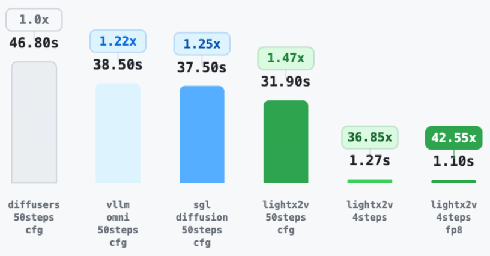

# Qwen Image

[English](README.md) | [简体中文](README_zh.md)

Set `lightx2v_path`, `model_path`, and `CUDA_VISIBLE_DEVICES` in the selected script. Commands below use repository-relative paths; absolute sh paths also work.

## Environment and weights

Complete the [environment setup](../../docs/EN/source/getting_started/quickstart.md).
Download only the models and additional weights needed for the selected task:

```bash
# download from huggingface
# Inference with 2512 text-to-image original model
hf download Qwen/Qwen-Image-2512 --local-dir Qwen/Qwen-Image-2512

# Inference with 2512 text-to-image step-distilled model
hf download lightx2v/Qwen-Image-2512-Lightning --local-dir lightx2v/Qwen-Image-2512-Lightning

# Inference with 2511 image editing original model
hf download Qwen/Qwen-Image-Edit-2511 --local-dir Qwen/Qwen-Image-Edit-2511

# Inference with 2511 image editing step-distilled model
hf download lightx2v/Qwen-Image-Edit-2511-Lightning --local-dir lightx2v/Qwen-Image-Edit-2511-Lightning
```

Keep `model_path` pointed at the complete base model directory. Set the checkpoint
and LoRA paths in the selected JSON to the downloaded local files.

## Basic tasks

| Task | Weights | Script |
| --- | --- | --- |
| Text to image | Qwen-Image-2512 | [qwen_image_t2i_2512.sh](qwen_image_t2i_2512.sh) |
| Image editing | Qwen-Image-Edit-2511 | [qwen_image_i2i_2511.sh](qwen_image_i2i_2511.sh) |
| Image layering | Qwen-Image-Layered | [qwen_image_i2i_layered.sh](qwen_image_i2i_layered.sh) |

```bash
bash scripts/qwen_image/qwen_image_t2i_2512.sh
```

Set prompts, input images, seed, and output path in the command. Select a [config](../../configs/qwen_image) with `--config_json`. The Layered script also requires setting its Diffusers source path.

Image editing accepts multiple inputs, corresponding to Image 1, Image 2, and so on in the prompt:

```bash
--image_path "/path/to/1.png,/path/to/2.png,/path/to/3.png"
```

## Server and requests

| Service | Launcher |
| --- | --- |
| Single-GPU text to image | [start_server_t2i.sh](../server/start_server_t2i.sh) |
| Single-GPU image editing | [start_server_i2i.sh](../server/start_server_i2i.sh) |
| Eight-GPU image editing (CFG2 × SP4) | [start_server_i2i_dist.sh](server/start_server_i2i_dist.sh) |

For example, start the text-to-image server, then send a request from another terminal:

```bash
bash scripts/server/start_server_t2i.sh
```

```bash
python scripts/server/post_sync_t2i_base64.py --prompt "A cat in a garden" --output result.png
```

Use this client for the image-editing server:

```bash
python scripts/server/post_sync_i2i_base64.py --prompt "Turn the image into a watercolor painting" --image_path /path/to/image.png --output result.png
```

Clients connect to `http://127.0.0.1:8000` by default; override it with `--url`. The image client uploads local images as Base64. When sending your own POST request, `image_path` can also be an absolute path accessible to the server.

## Multi-GPU

| Example | Parallelism | Script |
| --- | --- | --- |
| Image editing | Eight GPUs, CFG2 × SP4 | [qwen_image_i2i_2511_dist.sh](qwen_image_i2i_2511_dist.sh) |
| Lightning text to image | Four GPUs, SP4 | [qwen_image_t2i_2512_distill_dist.sh](inference/distill/qwen_image_t2i_2512_distill_dist.sh) |

When changing parallelism, update `CUDA_VISIBLE_DEVICES` and `--nproc_per_node` together. The process count is `cfg_p_size × seq_p_size`, with omitted dimensions treated as 1.

## Advanced features

### Compilation and reuse

For text-to-image compilation, select [qwen_image_t2i_2512_compile.json](../../configs/qwen_image/qwen_image_t2i_2512_compile.json). For image editing, add these fields to the base JSON:

```json
{
    "use_compile": true,
    "rms_norm_type": "sgl-kernel"
}
```

To reuse encoded inputs for image editing:

```bash
bash scripts/qwen_image/server/start_server_i2i_reuse.sh
```

Set the prompt and image path in the client, then run it from another terminal:

```bash
python scripts/qwen_image/server/post_i2i_reuse.py
```

Use `reuse=False` for the first request and `True` for reuse requests. Keep prompts, image paths, and image contents unchanged; the seed may change. This server example also enables compilation.

For text to image, add these fields to the compile config above and set `reuse` in requests. Use separate cache directories for different models and tasks:

```json
{
    "enable_reuse": true,
    "reuse_cache_path": "save_results/reuse_cache/qwen_image_t2i_2512"
}
```

### Distillation and FP8

| Example | Script | Optional FP8 config |
| --- | --- | --- |
| Lightning text to image, 8 steps | [qwen_image_t2i_2512_distill.sh](inference/distill/qwen_image_t2i_2512_distill.sh) | [qwen_image_t2i_2512_distill_fp8.json](../../configs/qwen_image/qwen_image_t2i_2512_distill_fp8.json) |
| Lightning image editing, 8 steps | [qwen_image_i2i_2511_distill.sh](inference/distill/qwen_image_i2i_2511_distill.sh) | [qwen_image_i2i_2511_distill_fp8.json](../../configs/qwen_image/qwen_image_i2i_2511_distill_fp8.json) |
| Zoe text to image, 4 steps | [qwen_image_t2i_2512_distill_zoe.sh](inference/distill/qwen_image_t2i_2512_distill_zoe.sh) | [qwen_image_t2i_2512_distill_zoe_fp8.json](../../configs/qwen_image/qwen_image_t2i_2512_distill_zoe_fp8.json) |

Scripts default to BF16 LoRA or distilled weights. For FP8, use the same script and switch `--config_json` to the matching config. Keep `model_path` pointing to the complete base model directory and set local weight paths in `lora_configs`, `dit_original_ckpt`, or `dit_quantized_ckpt` as required by the selected JSON. Omit `negative_prompt`, including empty strings, when `enable_cfg` is `false`.

### Other acceleration options

| Feature | Usage |
| --- | --- |
| TensorRT VAE | Select the [T2I config](../../configs/qwen_image/qwen_image_t2i_2512_trt.json) or [I2I config](../../configs/qwen_image/qwen_image_i2i_2511_trt.json) in the base script and set `trt_vae_config.trt_engine_path`. They use static and multi-profile engines, respectively. |
| LightLLM text encoder | Use the [kernel script](inference/text_encoder/qwen_image_i2i_2511_kernel.sh) or [service script](inference/text_encoder/qwen_image_i2i_2511_service.sh). Service mode requires a running LightLLM server and `lightllm_config.service_url`; see the [deployment guide](../../docs/EN/source/deploy_guides/qwen_image_encoder.md). |
| Shared CPU offload | See the [usage guide](inference/shared_offload/README.md). Configs are in `configs/qwen_image/shared_offload/`. |
| Baseline / contiguous layouts | See the [usage guide](inference/offload_layout/README.md) for GPU and NPU examples. |

## Python API examples

See the [Python API guide](../../docs/EN/source/getting_started/python_api.md) for
generator setup, configuration precedence, offload and repeated generation.
Edit paths in the selected file, then run it from the repository root after installation.
These examples retain their own model, sampling and attention settings; using a
Shell launcher's JSON is an explicit change of configuration.

| Use case | Steps | Python entry |
| --- | --- | --- |
| Edit 2511 FP8 | 4 | [qwen_2511_fp8.py](inference/qwen_2511_fp8.py) |
| Edit 2511 LoRA | 4 | [qwen_2511_with_distill_lora.py](inference/qwen_2511_with_distill_lora.py) |
| Edit 2511 FP8 + dynamic LoRA | 4 | [qwen_2511_with_distill_lora_dynamic.py](inference/qwen_2511_with_distill_lora_dynamic.py) |
| Edit 2511 switch LoRA | 8 | [qwen_2511_with_distill_lora_dynamic_switch_lora.py](inference/qwen_2511_with_distill_lora_dynamic_switch_lora.py) |
| 2512 FP8 | 4 | [qwen_2512_fp8.py](inference/qwen_2512_fp8.py) |
| 2512 LoRA | 4 | [qwen_2512_with_distill_lora.py](inference/qwen_2512_with_distill_lora.py) |
| 2512 FP8 + dynamic LoRA | 4 | [qwen_2512_with_distill_lora_dynamic.py](inference/qwen_2512_with_distill_lora_dynamic.py) |
| Qwen Image dynamic LoRA | 4 | [qwen_image_with_distill_lora_dynamic.py](inference/qwen_image_with_distill_lora_dynamic.py) |

The four-step examples use the released four-step weights, following the
[official inference examples](https://github.com/ModelTC/LightX2V-Qwen-Image-Lightning#run-4-step-edit-2511-model).
The LoRA-switching example uses local LoRA placeholders; choose two LoRAs compatible
with its eight-step settings. The eight-step Shell presets above use their matching weights.

### Recorded DiT timing comparison

The following figure records the Edit-2511 DiT comparison from 2025-12-23,
excluding warmup; it is not an end-to-end latency measurement.


