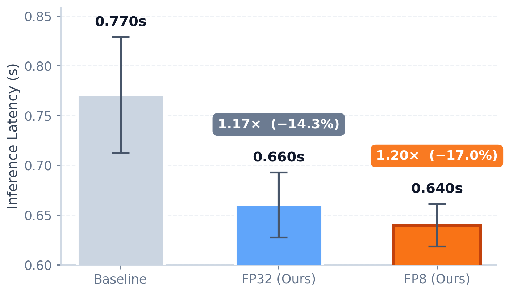

# WorldMirror Examples

This directory contains usage examples for HY-WorldMirror-2.0, a single-step multi-head 3D reconstruction model (depth / normal / camera / points / Gaussian splats) served through the LightX2V runner.

## Benchmark Results

<div align="center">
  
</div>

## Model Download

Before using the example scripts, you need to download the corresponding weights. The model can be downloaded from the following address:

3D Reconstruction Model
- [HY-WorldMirror-2.0](https://huggingface.co/tencent/HY-World-2.0)

The downloaded directory should contain a `HY-WorldMirror-2.0/` subfolder with `model.safetensors` and `config.json` inside.

## Usage Method 1: Using Bash Scripts (Highly Recommended)

For environment setup, we recommend using our Docker image. Please refer to the [Quick Start Guide](../../docs/EN/source/getting_started/quickstart.md).

```
git clone https://github.com/ModelTC/LightX2V.git
cd LightX2V/scripts/worldmirror

# Set lightx2v_path and model_path at the top of the script.
# Edit --input_path and --save_result_path in the command as needed.
```

3D Reconstruction Models
```
# Inference with the fp32 reconstruction model (default precision, 1e-3 MAE vs. upstream reference)
bash run_worldmirror_recon.sh

# Inference with the fp8-pertensor quantized model, saves ~0.6 GB GPU peak at slightly faster speed
# (1e-2 MAE vs. reference). Requires the calibrated input-scale file bundled under
# configs/worldmirror/worldmirror_input_scales.safetensors — already referenced from the config.
bash run_worldmirror_recon_fp8.sh
```

Both scripts include `--save_rendered --render_interp_per_pair 15` to render a Gaussian-splat flythrough
video into `<save_result_path>/<case>/<timestamp>/rendered/rendered_rgb.mp4`. Remove `--save_rendered`
to skip it, or add `--render_depth` to also render a depth flythrough. The SP script uses two GPUs.

Relative `input_scale_file` paths are resolved from the LightX2V repository root; absolute paths are used directly.

## Python API

After installation, run this code from the repository root. Select
`worldmirror_recon_fp8.json` instead for FP8, or set `config["enable_bf16"] = True`
before building the runner for BF16.

```python
import json

from lightx2v.models.runners.runner_factory import build_runner
from lightx2v.utils.set_config import build_startup_config

with open("configs/worldmirror/worldmirror_recon.json") as f:
    config = json.load(f)
config["model_path"] = "/path/to/HY-World-2.0"
runner = build_runner(build_startup_config(config))
request = runner.prepare_request({
    "input_path": "/path/to/scene_dir",
    "save_result_path": "/path/to/output",
    "return_result_tensor": True,
})
result = runner.run_request(request)
print(result["output_dir"])
print(result["timings"])
```

WorldMirror delivers reconstruction results as files. An omitted or `None`
`save_result_path` uses `./inference_output/<scene>/<timestamp>/`;
`strict_output_path` overrides this layout and writes directly to the chosen directory.
The return value always contains `output_dir`. Here `return_result_tensor=True`
adds `timings` (on rank 0; `None` on other ranks), rather than returning reconstruction
tensors. This preserves the programmatic inspection path separately from the CLI.

## Interactive and advanced CLI

[run_worldmirror.py](run_worldmirror.py) supports per-head disabling, masks,
camera/depth priors, training YAML plus checkpoint loading, rendering and the `>>>`
interactive loop. Omit `--no_interactive` to process more scenes with the loaded model.

```bash
python scripts/worldmirror/run_worldmirror.py \
    --input_path /path/to/scene_dir \
    --pretrained_model_name_or_path /path/to/HY-World-2.0 \
    --lightx2v_config configs/worldmirror/worldmirror_recon_fp8.json \
    --save_rendered --no_interactive
```
